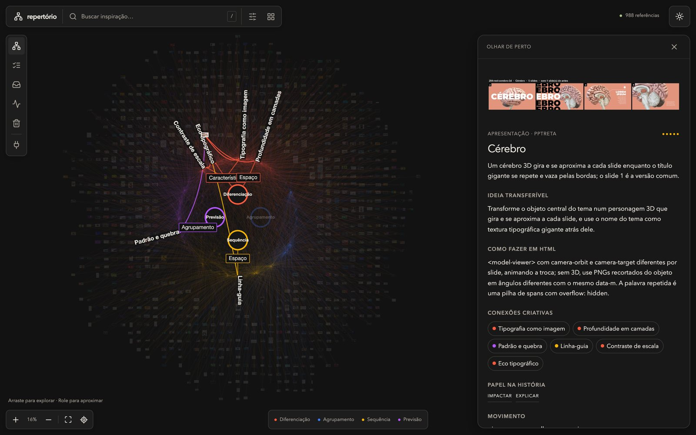
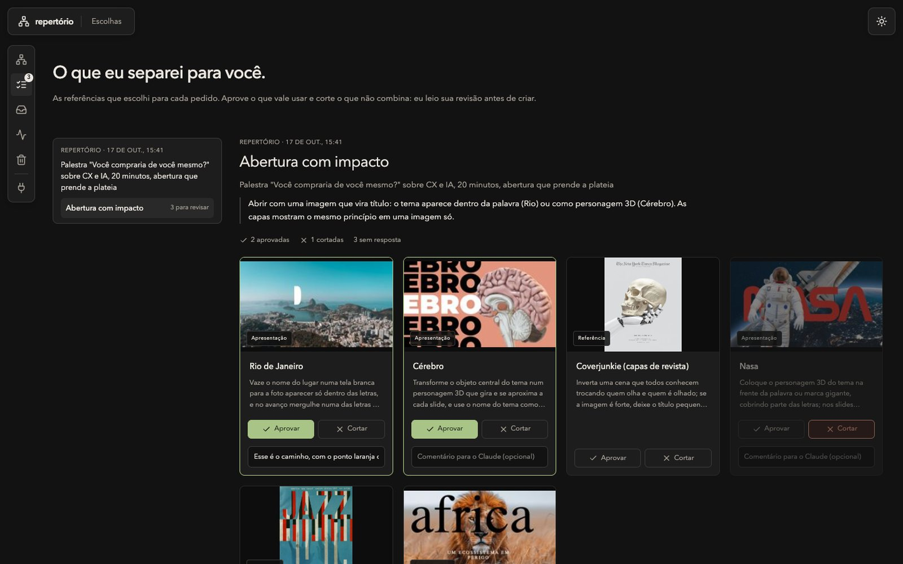

<p align="center"></p>

<h1 align="center">Repertório</h1>

<p align="center">Biblioteca visual local para criar apresentações, sites e vídeos originais, sozinho ou com agentes de IA.</p>

O Repertório organiza referências em espaços independentes. **PPT Treta** reúne o acervo do curso PPTRETA e estudos de apresentações, anúncios e outras linguagens visuais. **Growmate** reúne os materiais e referências da marca. Cada espaço tem sua curadoria, suas escolhas e seu mapa.

As referências compartilham um vocabulário criativo: o papel de cada peça na história, a técnica que prende o olho e o movimento entre slides. Assim, novos acervos podem entrar no projeto sem assumir o nome ou a identidade dos anteriores.

Ele foi feito para trabalhar junto com agentes (Claude Code, Codex, OpenCode). O agente busca referências aqui, mostra o que escolheu e só cria depois da sua revisão. A regra é inspirar, não copiar: a identidade visual vem sempre de quem pede.

As criações ficam no projeto a que pertencem. Por exemplo, uma capa de LinkedIn da Growmate é produzida em `growmate-marketing`, que consulta esta biblioteca pelo MCP. Rascunhos, imagens, prévias e arquivos finais ficam juntos naquele projeto. Uma criação só entra no acervo quando você pede sua incorporação.



## O app

- **Espaços:** separe acervos e marcas, mantendo a curadoria de cada um.
- **Mapa:** as quatro operações do olhar (diferenciação, agrupamento, sequência e previsão) no centro, as técnicas em volta e cerca de mil peças ligadas a elas. Zoom até 400% com imagens nítidas.
- **Olhar de perto:** a ficha de cada peça, com a ideia que dá para levar, como fazer em HTML e as conexões criativas. A prévia abre em destaque, slide por slide, com zoom.
- **Busca:** entende pedidos em português comum, como "abertura com impacto" ou "números grandes em fundo escuro".
- **Escolhas:** as referências que o agente separou para cada pedido, para você aprovar, cortar e comentar antes da criação.
- **Skills, Atividade e Lixeira:** habilidades escolhidas pelo usuário, histórico e exclusões com desfazer. Sugestões dos agentes ficam em Escolhas.



## Como rodar

Requisitos: macOS, Python 3.12, [uv](https://docs.astral.sh/uv/), Node.js 22.12 ou mais novo e pnpm 11.

```sh
./app/setup.sh        # primeira vez: instala, compila a interface e importa o acervo
./app/run.sh serve    # abre em http://127.0.0.1:8766
```

No Mac, `./app/mac/build.sh ~/Applications/Repertório.app` gera o app com janela própria e ícone no Dock. Ele mantém o serviço ligado e o religa se cair. O passo a passo para abrir junto com o Mac está em [app/README.md](app/README.md).

## Conectar agentes

O serviço oferece MCP em `http://127.0.0.1:8766/mcp`.

```sh
claude mcp add --transport http -s user repertorio http://127.0.0.1:8766/mcp
codex mcp add repertorio --url http://127.0.0.1:8766/mcp
```

| ferramenta | para quê |
|---|---|
| `start_context` | abre um pedido (uma apresentação, um carrossel) |
| `search_references` | busca em português comum e devolve uma prancha numerada com as prévias |
| `get_reference` | ficha completa, com imagem |
| `build_inspiration_pack` | guarda a seleção e devolve o link da tela Escolhas |
| `get_pack` | lê o que você aprovou, cortou e comentou |
| `register_reference` | incorpora ao acervo um material aprovado |

Sem o MCP, a mesma busca funciona pelo terminal: `./app/run.sh search "abertura com impacto" --prancha`.

## O que tem aqui

| pasta | o que é |
|---|---|
| `app/` | o app: serviço local em Python, interface em React e app do Mac |
| `biblioteca/` | o conhecimento em texto: processo, princípios de narrativa e direção de arte, páginas por intenção, técnica e movimento |
| `dados/` | os mesmos dados para máquina: fichas, slides, transições, mídia e vocabulário |
| `kit/` | motor de apresentação em HTML, com efeito Morph entre slides, passos e exportação em PDF |
| `ferramentas/` | busca, roteiro, conferência visual e arquivo único, pelo terminal |
| `_catalogo/` | catálogo de slides e mapa navegável do acervo |
| `_referencias/` | estudos completos das referências externas (só os textos) |
| `app/.runtime/` | curadoria e dados internos do app, cache de buscas e evidências de manutenção, fora do Git |

[AGENTS.md](AGENTS.md) é o manual que os agentes leem ao abrir a pasta. [LEIA-ME.md](LEIA-ME.md) explica o uso no dia a dia.

A pasta principal é `repertorio/`; `app/` contém o software. A organização e a mudança dos caminhos estão registradas em [docs/ORGANIZACAO.md](docs/ORGANIZACAO.md).

## O que não está no repositório

Os arquivos originais do curso (`_originais/`, cerca de 12 GB), as mídias extraídas e as imagens geradas a partir deles ficam fora do git (veja o [.gitignore](.gitignore)). Sem essas pastas, o app funciona, mas as imagens não aparecem.

A curadoria feita no app (exclusões, edições, revisões em Escolhas) fica em `app/.runtime/`. O próprio serviço copia essa curadoria e este histórico toda semana para o iCloud Drive, guardando as 6 cópias mais recentes.

## Uso

Repositório privado, para uso pessoal. O acervo do PPTRETA e as referências externas são material de terceiros: servem de inspiração e não entram em material de cliente.
