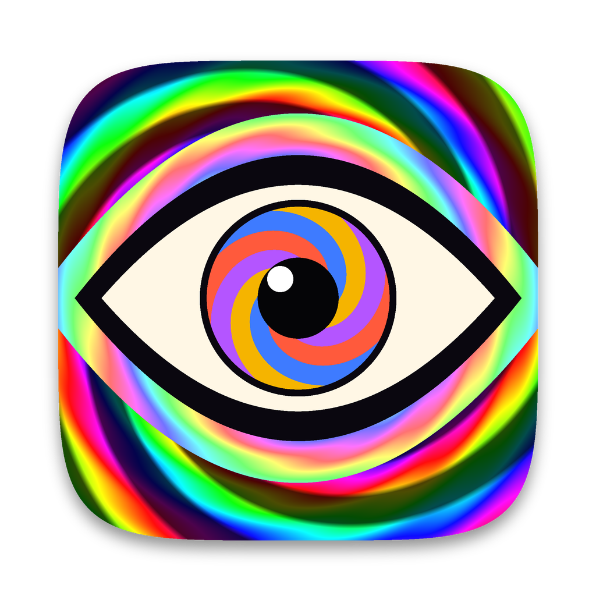
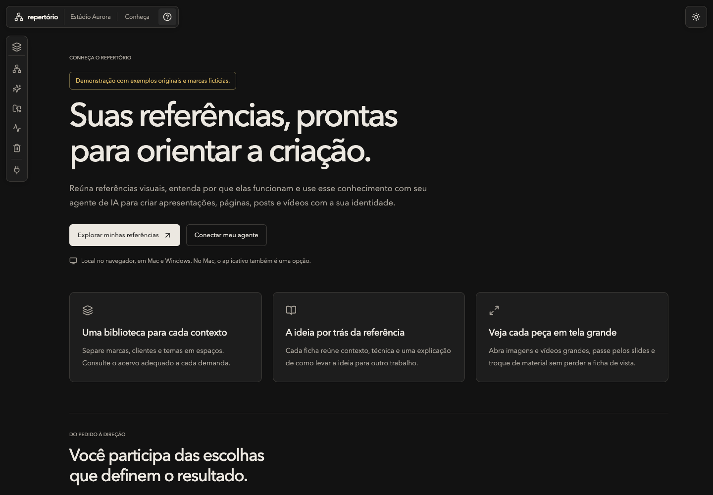

<p align="center">
  
</p>

<h1 align="center">Repertório</h1>

<p align="center"><strong>Suas referências, prontas para orientar a criação.</strong></p>

Repertório é uma biblioteca visual que você e seu agente de IA podem consultar. Reúna referências, entenda a ideia por trás de cada uma e escolha uma direção antes de criar apresentações, páginas, posts e vídeos com a identidade da sua marca.

**Funciona localmente no navegador, em Mac e Windows. No Mac, você também pode usar o aplicativo em uma janela própria.** As duas formas de acesso usam a mesma biblioteca do computador.

[Conheça o produto](docs/produto/PRODUTO.md) · [Instale e comece](docs/produto/INSTALACAO.md) · [Veja a demonstração](docs/produto/DEMONSTRACAO.md)

## O que ele resolve

Você guarda uma referência porque ela chama atenção. Quando precisa criar, ainda precisa encontrá-la, entender o recurso que funcionou e explicar ao agente como isso se relaciona com o seu trabalho.

O Repertório aproxima essas etapas. A referência ganha uma ficha com contexto, ideia transferível, técnica e explicação. Você encontra conexões pelo mapa e pela busca. O agente consulta o mesmo acervo e conta na conversa quais referências vai usar e por quê.

## Como funciona

1. **Reúna suas referências.** Organize marcas, clientes ou temas em espaços independentes. O cadastro e a descrição dos materiais podem ser feitos pelo agente conectado.
2. **Encontre uma direção.** Explore o mapa, busque uma ideia e abra a ficha para entender o recurso por trás da referência.
3. **Combine a direção.** O agente diz quais referências vai usar e por quê, com links que abrem cada uma no app.
4. **Crie no projeto de destino.** O agente aplica a direção aprovada com a sua identidade. Rascunhos e entregas ficam no projeto da produção.

Se quiser guardar um resultado como referência, peça para incorporá-lo ao acervo.



## Para quem serve

Para designers, profissionais de marketing, criadores e equipes que produzem apresentações ou conteúdo com agentes de IA e querem trabalhar a partir de referências que conhecem e escolheram.

Um profissional pode separar seus temas. Uma equipe pode manter espaços para marcas e clientes. Uma biblioteca local pode orientar vários projetos de produção no mesmo computador.

## O que você encontra

| Recurso | Como ajuda no trabalho |
| --- | --- |
| Espaços | Separam a curadoria de cada marca, cliente ou tema |
| Mapa visual | Mostra relações entre referências, intenções e técnicas, com nove visualizações |
| Busca e fichas | Ajudam a encontrar uma referência e entender sua aplicação |
| Conexão com agentes | Permite consultar o acervo na conversa do seu projeto, pelo padrão MCP |
| Catálogo de Skills | Ajuda a escolher uma habilidade e preparar o pedido para seu agente |
| Histórico e backup | Preservam decisões e a curadoria local |

As ferramentas de criação, skills e contas de IA são configuradas separadamente. A biblioteca funciona com materiais próprios ou autorizados; o acervo particular usado no desenvolvimento é separado do produto.

## Experimente

Depois da instalação, abra o guia dentro do app pelo botão **Conheça o Repertório**, ou acesse `http://127.0.0.1:8766/?view=guide`.

Para apresentar o produto com exemplos originais e marcas fictícias:

```sh
./app/run.sh demo --home app/.demo --serve
```

No Windows, depois da instalação:

```powershell
powershell -NoProfile -ExecutionPolicy Bypass -File .\app\run.ps1 demo --home app\.demo --serve
```

Abra `http://127.0.0.1:8768/?view=guide`. A demonstração tem dados próprios, outra porta e não importa sua biblioteca. [Roteiro de cinco minutos](docs/produto/DEMONSTRACAO.md).

## Instalação e operação

O [guia de instalação](docs/produto/INSTALACAO.md) mostra o caminho para Mac, Windows e o aplicativo opcional do Mac. A preparação pelo código-fonte usa Python 3.12, uv e, para compilar a interface, Node.js 22.12 ou superior e pnpm 11. Pacotes de avaliação podem levar a interface já compilada.

[LEIA-ME.md](LEIA-ME.md) orienta o uso. [app/README.md](app/README.md) documenta a manutenção. [AGENTS.md](AGENTS.md) contém as instruções de desenvolvimento e curadoria.

## Preparação comercial

A definição do produto, o roteiro de demonstração, as decisões de oferta ainda abertas e a preparação do pacote estão em [docs/produto/COMERCIALIZACAO.md](docs/produto/COMERCIALIZACAO.md). O pacote de avaliação usa uma lista explícita de arquivos do software e não inclui a biblioteca particular, projetos de clientes ou materiais de cursos.

Perestroika e SOAP permanecem na biblioteca de desenvolvimento para documentação futura. Essa preparação não publica o repositório, não define preço e não concede uma licença de redistribuição para os materiais do acervo.
