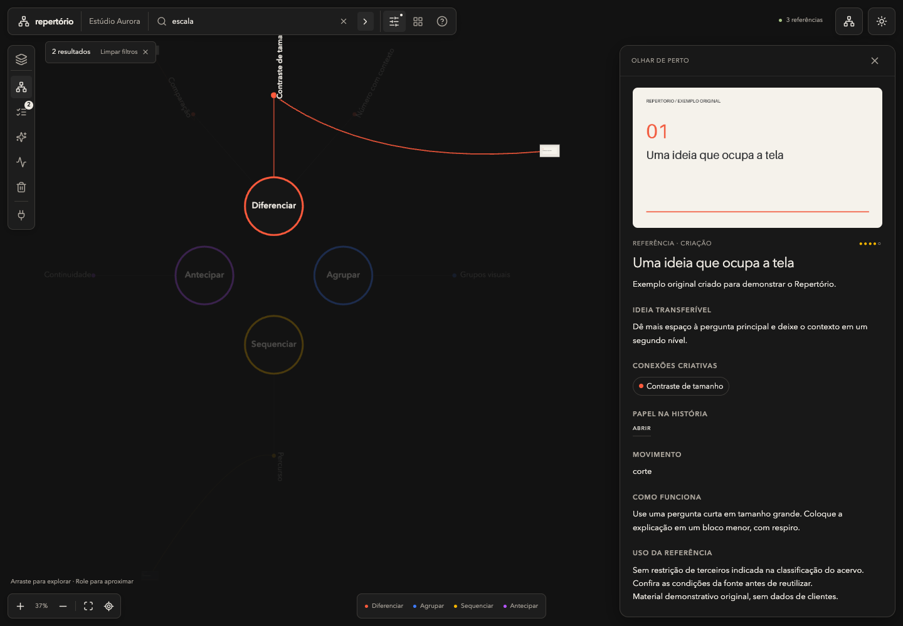

# Repertório

## Definição

Repertório é uma biblioteca visual local para pessoas e agentes de IA. Organiza referências em espaços, explica a ideia por trás de cada peça e registra a direção que o usuário aprovou antes da criação.

Frase principal: **Suas referências, prontas para orientar a criação.**

Explicação em uma frase: **Reúna referências, entenda por que elas funcionam e use esse conhecimento com seu agente de IA para criar com a identidade da sua marca.**

## O trabalho que a pessoa quer fazer

“Quero que a IA use as referências que eu escolhi, entenda o que funciona nelas e espere minha decisão antes de produzir.”

O público inicial a validar são profissionais de marketing, designers, criadores e equipes que já trabalham com agentes de IA. A dor a investigar é recuperar referências e transformar o que elas têm de útil em uma direção clara para o próximo trabalho.

## Exemplo concreto

Uma pessoa quer uma capa de LinkedIn. No projeto da produção, pede ao agente que consulte os espaços escolhidos do Repertório. O agente busca referências, abre as fichas e diz na conversa quais vai usar e o que pode ser aplicado, com links para cada uma. A pessoa confere no app, pede ajustes e o agente cria a capa com a identidade da empresa. Os arquivos ficam no projeto daquela produção.

O mesmo fluxo se aplica a uma apresentação, uma página, um carrossel ou um vídeo. O tipo de entrega depende das ferramentas de criação disponíveis ao agente.

## A função de cada parte

| Parte | Responsabilidade |
| --- | --- |
| Repertório | Acervo, busca, mapa, fichas e histórico da curadoria |
| Usuário | Contexto, seleção dos espaços, identidade e revisão da direção |
| Agente de IA | Consulta do acervo, interpretação do pedido e produção com as ferramentas disponíveis |
| Projeto da produção | Roteiro, rascunhos, imagens, prévias e arquivos finais |

## Formas de usar

| Sistema | Navegador local | Aplicativo |
| --- | --- | --- |
| Mac | Sim, com o serviço local em execução | Opcional, em janela própria, usando o mesmo serviço |
| Windows | Sim, com o serviço local em execução | O acesso preparado é pelo navegador |

O app do Mac e o navegador são duas formas de acessar a mesma instalação local. O aplicativo mantém o serviço ligado no Mac. No Windows, o iniciador abre o serviço em uma janela de terminal, que permanece aberta durante o uso.

## Compromissos da comunicação

- Mostrar o fluxo real de busca, ficha, revisão e produção no projeto.
- Explicar que as ferramentas e contas de IA são configuradas separadamente.
- Usar dados, imagens e marcas fictícias na demonstração compartilhável.
- Descrever o tamanho do acervo do cliente como resultado de sua própria curadoria. As contagens da biblioteca de desenvolvimento não são conteúdo contratado.
- Apresentar o uso local com precisão: o acervo fica no computador; consultas feitas por agentes seguem também as regras do serviço de IA escolhido.
- Medir resultados com usuários antes de publicar promessas de economia de tempo, desempenho ou qualidade.

## Capacidade atual e decisões abertas

O produto tem serviço local, interface web, aplicativo do Mac, espaços, revisão de seleções, catálogo de Skills e conexão com agentes. A inicialização limpa começa com uma biblioteca vazia e vocabulário próprio. A demonstração contém seis referências originais, dois espaços e uma seleção para revisão.

Preço, modelo de licença, suporte, atualizações e eventual acesso ao código-fonte ainda são decisões comerciais do proprietário. A validação de cada sistema e as pendências de distribuição são registradas em [COMERCIALIZACAO.md](COMERCIALIZACAO.md).
